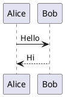

# Neovim Language & Documentation Tooling Cheatsheet

## 1. Quick Reference

| Language / format | Treesitter | LSP | Formatter / linter | External tool |
|---|---|---|---|---|
| C++ | `cpp` | `clangd` | clang-format / clangd | `clangd` |
| Python | `python` | `pyright` | Ruff | `ruff` |
| Bash | `bash` | `bashls` | ShellCheck + shfmt | `shellcheck`, `shfmt` |
| CMake | `cmake` | — | — | — |
| JSON | `json` | `jsonls` | — | — |
| YAML | `yaml` | `yamlls` | — | `yamllint` if desired |
| TOML | `toml` | Taplo | — | `taplo` |
| SQL | `sql` | — | — | — |
| HTML | `html` | — | — | — |
| JavaScript | `javascript` | `ts_ls` | — | `typescript-language-server` |
| TypeScript | `typescript` | `ts_ls` | — | `typescript-language-server` |
| AsciiDoc | dedicated syntax | — | — | `asciidoctor` |
| PlantUML | dedicated syntax | — | — | `plantuml` |

---

# 2. Treesitter

Treesitter provides parsing-based syntax highlighting and other structural features.

Check installed parsers:

```vim
:TSInstallInfo
```

Useful concept:

```text
Source file
    │
    ▼
Treesitter parser
    │
    ├── syntax highlighting
    ├── structural understanding
    └── indentation / other plugin features
```

Treesitter is **not an LSP**.

---

# 3. LSP

Neovim contains an LSP **client**.

The language server is an external process.

```text
Neovim
  │
  │ LSP protocol
  ▼
Language Server
```

Examples:

```text
C++         → clangd
Python      → pyright
Bash        → bashls
JSON        → jsonls
YAML        → yamlls
JavaScript  → ts_ls
TypeScript  → ts_ls
```

Check attached servers:

```vim
:LspInfo
```

Check diagnostics:

```vim
<leader>e
```

or:

```vim
:lua vim.diagnostic.open_float()
```

Common LSP keymaps:

```text
K          Hover documentation
gd         Go to definition
gD         Go to declaration
gr         Find references
gi         Go to implementation
gt         Go to type definition

<leader>cr Rename symbol
<leader>ca Code action
<leader>ci LSP info
```

Diagnostics navigation:

```text
]d         Next diagnostic
[d         Previous diagnostic
<leader>e  Show diagnostic
```

---

# 4. Mason

Mason is a package manager/installer for external developer tools.

Open:

```vim
:Mason
```

Install a package:

```vim
:MasonInstall <package>
```

For example:

```vim
:MasonInstall bash-language-server
```

Mason commonly installs tools under:

```text
~/.local/share/nvim/mason/
```

Executables are exposed through:

```text
~/.local/share/nvim/mason/bin/
```

For example:

```text
~/.local/share/nvim/mason/bin/shfmt
```

Check:

```bash
ls -l ~/.local/share/nvim/mason/bin/
```

Important:

**Mason does not replace the Neovim LSP client.**

The relationship is:

```text
Mason
  │
  └── installs language server
          │
          ▼
      ts_ls / clangd / pyright / ...
          │
          │ LSP protocol
          ▼
      Neovim LSP client
```

---

# 5. Mason-LSPConfig

`mason-lspconfig.nvim` connects Mason with `nvim-lspconfig`.

Example:

```lua
ensure_installed = {
    "lua_ls",
    "clangd",
    "pyright",
    "bashls",
    "jsonls",
    "yamlls",
    "ts_ls",
}
```

Conceptually:

```text
ensure_installed
       │
       ▼
Mason checks whether package exists
       │
       ├── installed → nothing to do
       │
       └── missing → install it
```

It does **not** mean:

> "Enable this language server for every file."

The actual LSP configuration happens separately:

```lua
lspconfig.clangd.setup({})
lspconfig.pyright.setup({})
lspconfig.ts_ls.setup({})
```

---

# 6. nvim-lspconfig

`nvim-lspconfig` provides configuration helpers for language servers.

Example:

```lua
lspconfig.ts_ls.setup({})
```

This tells Neovim how to configure the `ts_ls` server.

The complete chain is:

```text
Mason
  │
  │ installs
  ▼
typescript-language-server
  │
  │ started by
  ▼
Neovim LSP client
  │
  │ configured through
  ▼
nvim-lspconfig
```

---

# 7. Python

Current setup:

```text
Python
 ├── Treesitter
 ├── Pyright       → LSP
 └── Ruff          → linting / formatting
```

Format:

```text
<leader>cf
```

Your Conform configuration uses:

```lua
python = { "ruff_format" }
```

So:

```text
<leader>cf
    │
    ▼
Conform
    │
    ▼
ruff_format
    │
    ▼
Ruff
```

---

# 8. Bash

Current setup:

```text
Bash
 ├── Treesitter
 ├── bashls        → LSP
 ├── ShellCheck    → diagnostics/linting
 └── shfmt         → formatting
```

Check ShellCheck:

```bash
shellcheck --version
```

Check shfmt:

```bash
shfmt --version
```

Mason-installed shfmt may be available as:

```bash
~/.local/share/nvim/mason/bin/shfmt
```

Mason binaries do not necessarily appear in your normal shell `$PATH`.

---

# 9. JSON

Current setup:

```text
JSON
 ├── Treesitter
 └── jsonls → LSP
```

Check:

```vim
:LspInfo
```

Diagnostics:

```vim
<leader>e
```

---

# 10. YAML

Current setup:

```text
YAML
 ├── Treesitter
 └── yamlls → LSP
```

Check:

```vim
:LspInfo
```

YAML diagnostics are provided by `yamlls`.

---

# 11. TOML

Current setup:

```text
TOML
 ├── Treesitter
 └── Taplo
```

Taplo is installed as a standalone executable:

```bash
taplo --version
```

Current installation:

```text
~/.local/bin/taplo
```

The binary is maintained in the dotfiles repository and exposed from `$HOME` through a symlink.

Conceptually:

```text
~/.local/bin/taplo
        │
        ▼
~/Repos/dotfiles/.local/bin/taplo
```

---

# 12. HTML

Current setup:

```text
HTML
 ├── Treesitter
 └── nvim-ts-autotag
```

`nvim-ts-autotag` provides automatic tag handling.

Example:

```html
<h1>Hello</h1>
```

Changing the opening tag:

```html
<h2>Hello</h1>
```

automatically updates the closing tag:

```html
<h2>Hello</h2>
```

Current configuration uses:

```lua
require("nvim-ts-autotag").setup()
```

Do not configure it through the deprecated Treesitter `autotag` module.

---

# 13. JavaScript / TypeScript

JavaScript:

```text
JavaScript
 ├── Treesitter
 └── ts_ls → LSP
```

TypeScript:

```text
TypeScript
 ├── Treesitter
 └── ts_ls → LSP
```

`ts_ls` is backed by:

```text
typescript-language-server
```

Check:

```vim
:LspInfo
```

Diagnostics:

```vim
<leader>e
```

---

# 14. AsciiDoc

AsciiDoc uses a different model.

```text
.adoc
 │
 ├── Neovim
 │     └── syntax highlighting
 │
 └── Asciidoctor
       │
       ▼
      HTML
```

Render:

```bash
asciidoctor document.adoc
```

Output:

```text
document.html
```

Check installation:

```bash
asciidoctor --version
```

AsciiDoc does not require an LSP for the current workflow.

---

# 15. PlantUML

PlantUML also does not require an LSP.

Current setup:

```text
.puml
 │
 ├── Neovim
 │     └── PlantUML syntax
 │
 └── PlantUML
       │
       ▼
     PNG/SVG
```

Render:

```bash
plantuml diagram.puml
```

Check:

```bash
plantuml -version
```

Example:



Render:

```bash
plantuml diagram.puml
```

---

# 16. AsciiDoc + PlantUML

These tools can be combined for documentation.

Conceptually:

```text
documentation.adoc
       │
       ├── normal AsciiDoc
       │
       └── PlantUML diagram
                │
                ▼
            PlantUML
                │
                ▼
             diagram
                │
                ▼
           Asciidoctor
                │
                ▼
          documentation.html
```

This makes AsciiDoc useful as a documentation source format for architecture and engineering notes.

---

# 17. Formatting

Formatting is separate from LSP.

Your current Python workflow uses Conform:

```text
<leader>cf
      │
      ▼
Conform
      │
      ▼
ruff_format
```

Current Python formatter:

```lua
python = { "ruff_format" }
```

Formatting on save is configured for Python.

---

# 18. Diagnostics

Diagnostics can come from different sources.

Examples:

```text
LSP
 │
 ├── clangd
 ├── pyright
 ├── bashls
 ├── jsonls
 ├── yamlls
 └── ts_ls

External linter
 │
 ├── ShellCheck
 └── Ruff
```

Neovim collects these into its diagnostic system:

```lua
vim.diagnostic
```

Useful commands:

```vim
:lua vim.diagnostic.open_float()
```

```vim
:lua print(#vim.diagnostic.get(0))
```

---

# 19. The Big Picture

The most important distinction is:

```text
                    Neovim
                       │
        ┌──────────────┼──────────────┐
        │              │              │
    Treesitter       LSP client      Plugins
        │              │              │
        │              │              ├── Mason
        │              │              ├── Conform
        │              │              ├── Gitsigns
        │              │              └── ...
        │              │
        │              ▼
        │       Language servers
        │              │
        │       ┌──────┼──────┐
        │       │      │      │
        │    clangd  pyright ts_ls ...
        │
        ▼
   Parsers / syntax
```

Mason sits alongside these components as an **installer/package manager**:

```text
Mason
 │
 ├── installs LSP servers
 ├── installs formatters
 ├── installs linters
 └── installs other developer tools
```

It does not itself provide parsing, diagnostics, formatting, or the LSP protocol.

---

# 20. Useful Troubleshooting Commands

### What LSPs are attached?

```vim
:LspInfo
```

### What Treesitter parsers are installed?

```vim
:TSInstallInfo
```

### Mason packages

```vim
:Mason
```

### Current filetype

```vim
:set filetype?
```

### Current syntax

```vim
:verbose set syntax?
```

### Diagnostics

```vim
<leader>e
```

### All diagnostics in quickfix

```vim
:lua vim.diagnostic.setqflist()
:copen
```

### Reload Neovim configuration

```vim
:source ~/.config/nvim/init.lua
```

For plugin/configuration changes, restarting Neovim is often the cleanest option.

---

# 21. Mental Model

When adding support for a new language, ask:

### 1. Do I need parsing/highlighting?

Install/configure:

```text
Treesitter parser
```

### 2. Do I need code intelligence?

Use:

```text
LSP client + language server
```

### 3. Do I need formatting?

Use:

```text
Conform + formatter
```

### 4. Do I need linting?

Use:

```text
Linter
```

### 5. Where do I get the external tool?

Often:

```text
Mason
```

or Ubuntu/package manager, depending on the tool.

### 6. Is it a documentation/build tool?

Prefer a normal system/user installation.

Examples:

```text
Asciidoctor
PlantUML
```

The key principle:

> **Neovim is the editor and orchestrator. Most language intelligence and build/documentation work is performed by external tools.**